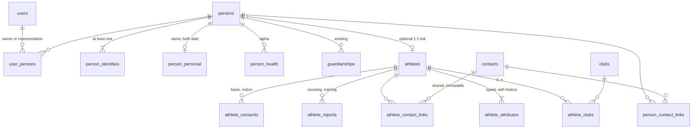

# ADR 0024: Athletes, persons, identities and contacts (data model revision)

- Status: Accepted as design on 2026-10-24 (answers recorded under "Decisions by Pedro"); implementation is M29 and not started
- Date: 2026-10-24
- Supersedes in part: ADR 0015 (identity on `persons`), ADR 0007 point 4 and ADR 0021/0022 (prospects)

## Context

Scouting deals with athletes who may never be members, users or persons. Today a scouted
athlete is a `prospects` row with about 45 columns (guardian, own contact, club as text, NIF,
retention), and `persons` holds identity and contacts as plain columns (`nif`, `email`,
`phone`, `federation_id`, `full_name`, `birth_date`). Consequences we already feel:

- Nothing keeps history: a changed phone number or height overwrites the old one.
- A person may have several identity documents (NIF, CC, passport), but `persons.nif` holds one.
- A contact (a parent's phone) is copied between prospect and person on link (ADR 0022), so
  the copies drift.
- `users.person_id` is unique: a parent cannot represent two children, and there is no way to
  say "owner of" versus "representative of".
- The upcoming registration flow (identity document, approval, CMD) needs identities with
  provenance (who verified, when, by what evidence).

Pedro's brief (2026-10-24) asks for: `athletes` (guid + metadata, attributes with history,
clubs, reports, contacts); `persons` (guid + metadata, identities, contacts with history,
personal data, health and medical as alpha); an optional person-athlete link with contact
merge; and users related to 0..n persons as owner or representative.

## Decision (proposed)

### 1. Shape

Every root table (`persons`, `athletes`, `contacts`) carries the same **metadata block**:
`id` (uuid, the guid), `code` (human handle: `RSC-` for persons as today, `ATL-` for
athletes), `created_at`, `created_by`, `updated_at`, `source` (`manual`, `import`, `scouting`,
`public_form`, `registration`, `cmd`), `status` (`active`, `archived`), `retain_until`,
`merged_into_id` (set when a duplicate is merged, see 7), `deleted_at`. History rows carry
`recorded_by` and `recorded_at` instead.

### 2. Athletes

`athletes`: metadata block only, plus `display_name text not null` (see the name rule) and
`person_id uuid null unique references persons` (the optional link). It also holds the
scouting pipeline `status` that `prospects` has today. Pipeline state is not an attribute.

**Attributes** (`athlete_attributes`): one append-only table, `athlete_id`, `type` (text key),
`value_text` / `value_num` / `value_date` (exactly one set, matched to the type's kind),
`precision` (for dates: `year` or `day`, because scouts often only know the birth year),
`source` (`observed`, `declared`, `document`), `valid_from`, `valid_to` (null = current),
`recorded_by`. The "history table" is this table itself: changing a value closes the current
row (`valid_to`) and inserts a new one, so there is no second table to keep in sync. A
partial unique index allows one current row per athlete and single-valued type. Types live
in a **code catalogue** in `@rsc/shared` like the scouting model (ADR 0021): key, value kind,
unit, cardinality (single or multiple, e.g. positions), sensitivity tier, and scope
(`identity` or `sporting`). Initial types: `name`, `nickname`, `date_of_birth`, `height_cm`,
`weight_kg`, `position`, `dominant_foot`, `nationality`, `birthplace`, `social_url`,
`media_url`, `federation_number`. Lists and filters read from a view
`athlete_current(athlete_id, ...)` (pivot of current rows) so screens never scan history.

**Name rule.** At least one current `name` or `nickname`, each of 2 to 80 characters after
trimming, made of Unicode letters and digits plus space, hyphen, apostrophe and full stop
(strictly alphanumeric would reject "D'Ávila", "João-Pedro", "Jr."), at least one letter
or digit. Enforced in one zod schema, and in the database by `athletes.display_name`, which
the service keeps in sync with the best current name or nickname, with a `CHECK` on length
and character class. A cross-row "at least one" cannot be a plain constraint, so the
denormalised column is the cheap guarantee.

**Clubs** (`athlete_clubs`): `athlete_id`, `club_id` (existing `clubs` table, or
`club_name` text fallback as today), `from_date`, `to_date`, `level` (escalão), `is_loan`.
Zero rows is valid. Current club = open row.

**Reports** (`athlete_reports`): today's `prospect_reports` renamed and generalised:
`kind` (`match`, `observation_training`, `training`, `evaluation`, `other`), author,
observed date, scores/heat/details as today. Evaluations of members (ADR 0007) stay as they
are for now and are listed as a later unification candidate, not part of this move.

**Contacts**: see 4. **Consents** (`athlete_consents`): see 6.

### 3. Persons and identities

`persons` keeps its id, `identity_code`, `is_pseudonymous` and the metadata block, and loses
(later, contract step) `nif`, `email`, `phone`, `federation_id`, `birth_date`, `full_name`.

**Identities** (`person_identities`): `person_id`, `type` (`nif`, `cc`, `bi`, `passport`,
`residence_permit`, `fpf_licence`, `rsc_code`), `issuing_country` (null for national
types), `value` (as typed), `value_normalised` (upper-case, no spaces or separators),
`verified_at`, `verified_by`, `evidence` (`document`, `cmd`, `import`, `self_declared`),
`valid_until` (documents expire; the number does not), `created_at`.
`UNIQUE (type, issuing_country, value_normalised)` (with `coalesce` for null country).
NIF and CC check digits are validated before insert.

**At least one identity.** Enforced by creating the person and its first identity in one
transaction and a deferrable constraint trigger that rejects a person with none at commit.
Because pseudonymous players and every imported person without a NIF exist today, each
person gets an automatic `rsc_code` identity from its `identity_code`; a person is
"verified" only when it also has a document or CMD identity with `verified_at`. This keeps
the rule honest without blocking existing data.

**Personal data** (`person_personal`, one row per person): `legal_name`, `preferred_name`,
`birth_date`, `sex`, `nationality`. Deliberately small, as requested. Name and birth date have
history through `person_personal_history` (same pattern as attributes) because legal name
changes and corrections of a wrong birth date must stay auditable.

**Health and medical (alpha)**: the existing `health` module stays the only home of
health data; it is re-keyed on `persons.id` (already so) and gated by the `health` module
flag and `authorizeHealthRead()`. No new tables here; nothing moves.

### 4. Contacts with history and merge on link

A **contact** is an immutable fact: `contacts(id, kind, value, address_json, created_at,
created_by, source)`, `kind` in `email`, `phone`, `address` (an address is a contact, as
asked; its structured fields live in `address_json`: line1, line2, postal code, locality,
country). Ownership and history live in link tables
`person_contact_links` / `athlete_contact_links`: `owner_id`, `contact_id`, `label` (`own`,
`home`, `work`, `guardian`, `other`), `is_primary`, `valid_from`, `valid_to`, `verified_at`.

Changing a phone number is never an update: the old link gets `valid_to`, a new contact and
link are created. History falls out of the link rows, and a contact shared by two owners
(siblings' parent phone) is never silently changed for the other owner.

**Link athlete to person**: for each athlete contact link not already present on the person
(same kind and normalised value), the person gets a link to the same `contacts` row, copying
`valid_from` and `valid_to`, so both owners show the same history. The UI asks first (as
today's two-column merge, ADR 0022); the choice per contact is recorded in `link_events`
so it can be undone (7).

### 5. Users and persons

`users.person_id` is replaced by `user_persons(user_id, person_id, relationship, status,
approved_by, approved_at, valid_from, valid_to)`; `relationship` in `owner`, `representative`;
`status` in `pending`, `approved`, `revoked`. Partial unique indexes: one approved owner per
person, one owned person per user. A user with no row is valid (the anonymous role of the
registration plan). Backfill: every `users.person_id` becomes an approved `owner` row.
Guardians stay modelled by `guardianships` (person to person); a parent user owns the parent's
person and is a `representative` of each child they are approved for. Representation of a
child ends automatically at 18 unless the (now adult) person consents.

### 6. Privacy rules the model must carry

- Identity values and contact values are `personal` tier; health stays `health`. Identity
  values are never logged, never put in URLs, and searched by `value_normalised` only for
  exact match.
- Athletes are mostly minors scouted without the guardian's knowledge. RGPD art. 14 requires
  telling the data subject (or guardian) within a month when data is not collected from
  them. `athlete_consents(athlete_id, basis, notice_version, given_by, given_at, informed_at,
  scope, withdrawn_at)` records the legal basis, who was informed and when; `retain_until`
  is mandatory (ADR 0007). A scheduled job lists athletes with no `informed_at` after 25 days.
- Scouting opinions about an identifiable child are personal data under the right of access
  (art. 15). Export (`privacy/export.ts`) must include athlete reports once linked.
- Erasure must reach history rows. History tables cascade on delete; the `audit` module
  stores field names and ids, never values.

### 7. Duplicates, merge and unlink

- Duplicate persons are caught by the identity unique key. Two persons later found to be one
  human need a **merge service** that repoints about 27 foreign keys and writes
  `merged_into_id`; designed here, built later.
- Duplicate athletes (two scouts, same boy) use the same `merged_into_id` mechanism, union the
  attributes (history preserved, conflicting current values left for a human) and keep both
  reports lists.
- Unlink is possible: `link_events` records which contact links were added by the link, so
  unlink removes only those. After a link, `identity`-scope attributes (name, date of birth)
  are read from the person; the athlete's own rows stay as history. `sporting` attributes
  stay with the athlete.

### 8. Modules (follows the module catalogue)

`athletes` does not depend on `persons` (it must work alone for scouting); `scouting` depends
on `athletes`. The link feature appears only when both are enabled. `registration` depends
on `persons` and `users`; `approvals` on `users`. Every new table belongs to one module.

## Migration plan (expand, then contract; one PR each)

1. **Expand persons** (migration 0025+): metadata columns, `person_identities` (backfill
   `nif`, `federation_id`, `rsc_code`), `contacts` and links (backfill `email`, `phone`),
   `user_persons` (backfill from `users.person_id`). Dual write: services write new and old.
   Old columns stay and are still read. Reversible by dropping the new tables.
2. **Athletes** : create `athletes`, attributes, clubs, consents. Backfill from `prospects`
   **keeping the same ids** (athlete id = prospect id), so reports, URLs, retention and the
   person link survive untouched. `current_club` becomes an `athlete_clubs` row (matching
   `clubs` by name, otherwise text); guardian and own contacts become contacts with the
   `guardian` or `own` label. Rename `prospect_reports` to `athlete_reports`
   (`prospect_id` to `athlete_id`).
3. **Switch reads/writes** of scouting, imports (ADR 0015 matching by NIF, federation
   number) and the public trial request to the new tables behind the module flag; keep
   `prospects` as a read-only fallback for one release.
4. **Personal data**: add `person_personal`, backfill, move readers. `persons.full_name`
   stays as a maintained display cache until every module prints from the view.
5. **Contract**: drop `prospects`, `persons.nif/email/phone/federation_id`,
   `users.person_id` after a release with no readers (grep and tests prove it).
   Update `PERSON_FIELD_TIERS` per table.

Each step needs a migration test on a copy of seeded demo data (fake only) and a rollback
note. Real data is never committed.

## Alternatives considered

- **Merge athletes into persons** with `is_pseudonymous` (ADR 0015). Simpler, but forces a
  "person" row, with identity requirements, for a child nobody has consented to hold. Rejected
  by Pedro's brief.
- **Current-values table plus a separate history table** for attributes. Two writes per
  change and a drift risk; the single temporal table has one source of truth.
- **Copy contacts on link.** Easy but drifts; shared immutable contacts keep one history.
- **Free-form attribute types.** Flexible, but untyped and invisible to sensitivity tiers;
  a code catalogue (as ADR 0021) keeps both.

## Consequences

- Filtering athletes by attributes goes through `athlete_current`; ad-hoc EAV queries are slow.
- Reads of a person's phone become a join; hide it behind the existing person services.
- More tables (about 14 new) and a longer migration; each step is separately shippable.
- The identity `rsc_code` row is a pragmatic bridge, not a verified identity.

## Decisions by Pedro (2026-10-24)

1. **Athletes are the sporting subject for everyone**, the club's own players included, not
   only scouted ones. Team membership (`team_members`, `class_members`), evaluations,
   call-ups and the `players` facet move from `persons` to `athletes`. A person that is not
   an athlete has no roster, evaluation or scouting data; "athletes with a person" is just a
   filter on `athletes.person_id`. Persons are the administrative identity (staff,
   guardians, members, users). Migration step 2 therefore creates an athlete for every
   existing `players` row, linked to its person, and a new step repoints the sporting tables.
2. **User to person is a back-office link**, made by an approval (registration flow) or an
   admin, never by the user alone. `user_persons.status` starts `pending`.
3. **Representatives are an alpha feature.** Only `owner` rows are used in beta and release;
   the `representative` relationship and parent access to children ship with the alpha tier.
4. **Identity issuer**: a small `identity_issuers` table (country, authority) referenced by
   `person_identities.issuer_id` (null for national types) replaces the plain country column.
   Uniqueness is `(type, issuer_id, value_normalised)`.
5. **Scouting needs no consent gate.** It is about athletes, not persons, holds no verified
   personal data yet and is mostly about minors. `athlete_consents` stays optional and
   non-blocking (an optional "informed on" date and basis); the 25-day reminder is dropped.
   `retain_until` stays mandatory. The art. 14 duty to inform remains a legal point to
   confirm with the club's lawyer or DPO before any real data is collected.
6. **Contact sharing**: the same `contacts` row is linked by two owners only when they
   genuinely share it (the link merge, or a family phone chosen by hand). Editing never
   changes a shared row: it closes the owner's own link and creates a new contact.
7. Accepted as proposed: internal `rsc_code` identity so every person has one (legacy
   persons: `nif` and `federation_id` are nullable today, so imported and pseudonymous
   persons have none), single temporal attribute table, identity-scope attributes read from
   the person once linked, and identity values hashed for lookup.
